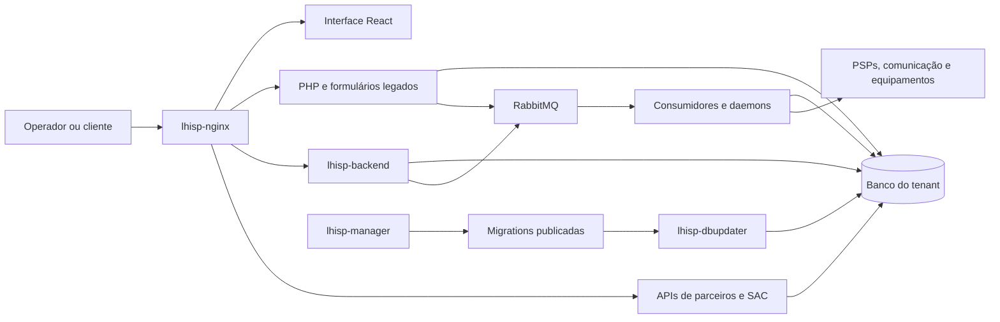

# Arquitetura e serviços do LHISP

> **Aviso:** Esta documentação foi gerada por inteligência artificial e pode conter erros.

Referência para desenvolvimento e suporte técnico. Descreve os checkouts locais examinados em **14/10/2026**; a composição instalada em cada servidor pode diferir.

## Caminhos principais

A interface usa tanto a API Node quanto ações do PHP. Uma tela convertida para React não implica que suas regras tenham saído do legado. Da mesma forma, salvar um registro pode apenas publicar trabalho em fila; a confirmação da tela não comprova a conclusão da integração externa.

## Onde procurar cada responsabilidade

| Repositório | Papel e entradas verificadas |
|---|---|
| `lhisp-frontend` | Interface administrativa React; rotas e telas em `src/paginas/`, consultas e mutações em `src/api/`. |
| `lhisp-php` | Formulários e regras legadas; `web/lhajax.php` recebe ações `Classe.Metodo`, implementadas em `web/inc/actions/`, com DAOs em `web/inc/classes/`. Também contém rotinas em `daemons/`. |
| `lhisp-backend` | API Express, regras de negócio, eventos e serviços. Entrada `src/lhisp-backend.js`; rotas em `src/rotas/`; BIs/modelos em `src/lhisp-business/src/`. |
| `lhisp-manager` | Gerência central, infraestrutura, assinatura de módulos, tarefas administrativas e migrations em `src/database/updates/`. A gerência usa uma instalação própria do LHISP; não é o banco de cada tenant. |
| `lhisp-dbupdater` | Aplica migrations numeradas e atualiza menus; entrada `src/dbupdate.js`. Veja [atualização do banco](/operacao/atualizacao-do-banco). |
| `lhisp-nginx` | Proxy e publicação das interfaces; `src/lhisp.conf.template` descreve o encaminhamento das rotas. |
| `lhisp-php-fpm` | Imagem/runtime PHP. Regras e páginas permanecem no repositório `lhisp-php`. |
| `lhisp-cobrancas` | Integrações com PSPs e processamento da cobrança. O [fluxo Pix](/financeiro/pix) pode envolver este serviço ou o monitor legado conforme a configuração da empresa. |
| `lhisp-pix` | Monitor Pix legado, com exclusão das empresas migradas ao fluxo novo. |
| `lhisp-api-parceiros` | [API de parceiros](/sistema/api-parceiros) e [MCP](/sistema/mcp). |
| `lhsac-backend` | API da central do assinante: autenticação, contratos, contas, documentos e atendimentos em `src/rotas.1.0.0.js`. |
| `lhisp-tecnico`, `app-tecnico` | Aplicações distintas para o técnico. A primeira possui rotas web/PWA; a segunda usa Expo. Não presumir paridade de funcionalidades ou de funcionamento offline. |
| `lhisp-vendas` | Interface de pré-vendas; complementa [pré-cadastros](/cadastros/pre-cadastros) e o [dashboard comercial](/dashboards/dashboard-comercial). |
| `lhisp-daemon-*`, `lhisp-radius`, `lhisp-rsyslog` | Comunicação, monitoramento, provisionamento e serviços de rede. Veja [operação dos serviços de rede](/rede-infra/operacao-servicos-rede). |
| `lhisp-eventbus-consumer`, `lhisp-getdbconfig`, `lhisp-logger` | Bibliotecas compartilhadas de consumo de eventos, configuração de bases e logs. Uma atualização da biblioteca precisa chegar ao pacote/imagem do consumidor para mudar seu comportamento. |
| `lhnfe` | Serviço fiscal complementar. Emissão também envolve o frontend, PHP e backend; verifique o caminho usado por cada tipo de nota. |
| `lhisp-importacoes` | Serviço de importação, separado dos scripts pontuais `web/fix/` do PHP. |

O compose de tenants em `lhisp-manager/docker-compose.yaml` também referencia `lhisp-task-runner`. Não havia checkout desse repositório neste workspace; os agendamentos desse componente não foram auditados.

## Rotas no proxy

| Caminho | Destino previsto no template |
|---|---|
| `/` | Interface administrativa publicada como arquivos estáticos. |
| `/central`, `/os` e arquivos `.php` | Aplicação PHP; há regras específicas de FastCGI para OS. |
| `/lhtec`, `/vendas` | Interfaces técnica e comercial. |
| `/api`, `/socket` | Backend Node e conexão de eventos da interface. |
| `/oidc`, `/oidc-interacao` | Provider OIDC e interação de autenticação, com regras distintas no proxy. |
| `/lhsac`, `/api-parceiros` | APIs da central e de parceiros. |
| `/cobrancas`, `/voip`, `/ott`, `/tr069`, `/importacoes` | Serviços especializados. |

Essa tabela descreve encaminhamento, sem substituir os requisitos de autenticação e autorização de cada rota. O template recebe valores e regras na geração da configuração; não é um inventário de portas expostas em produção.

## Contexto de banco e empresa

Serviços resolvem o banco da instalação e, dentro dele, a empresa/filial do usuário. O proxy encaminha contexto; os serviços também usam configuração local de bases. Na API funcional `getDbConfig`/`getDbNames` de `lhisp-getdbconfig`, o caminho padrão é `/etc/lhisp/databases.json` e pode ser alterado por `LHISP_DATABASE_FILE`. A classe `ConfigService` tem carregamento próprio e ainda lê o caminho fixo, apesar de verificar existência por outra variável. Confirme qual API cada consumidor utiliza antes de mudar o caminho do arquivo.

Para investigar uma divergência, registre versão do componente, empresa/filial, rota ou ação, horário e identificador do registro. Correlacione `traceId` quando disponível. Não copie o arquivo de bases nem credenciais para chamados: ele contém parâmetros de conexão sensíveis.

## Limites desta referência

- Não comprova imagens, migrations, filas ou agendamentos implantados em um tenant.
- A presença de uma rota no frontend não comprova uma implementação compatível no backend instalado.
- Planos em `docs/` dos repositórios de código descrevem também trabalho futuro; confirme implementação antes de tratá-los como funcionalidades disponíveis.
- Backups, restauração, retenção de logs e resposta a incidentes ainda precisam de procedimentos próprios com validação operacional.
